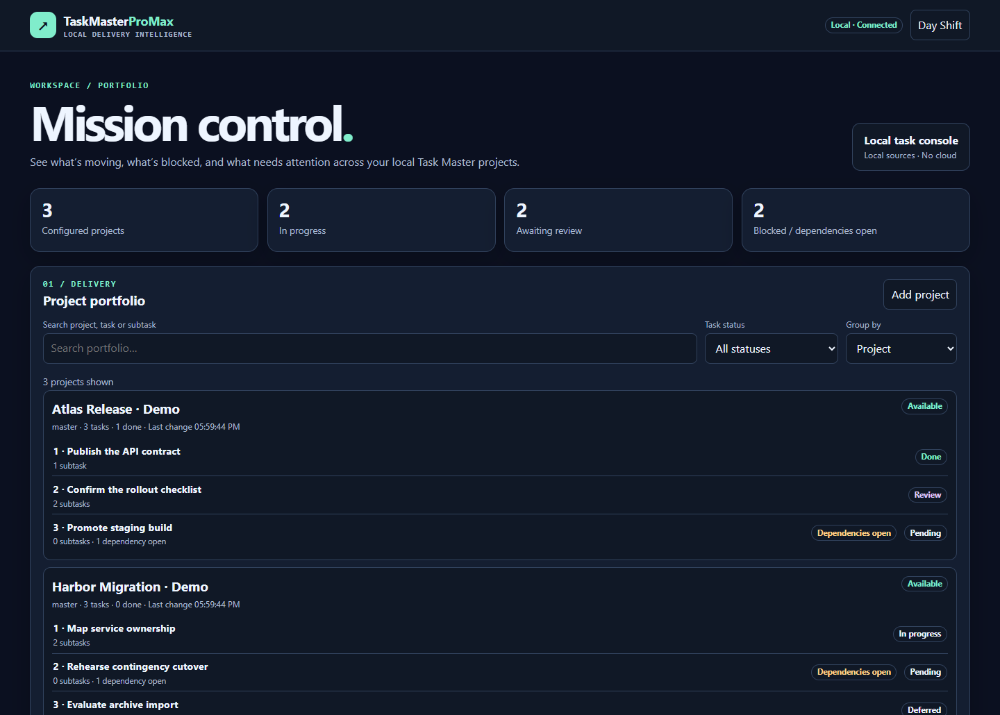

# TaskMasterProMax

**Privacy-first task management for AI coding agents, with a local multi-project dashboard.**

TaskMasterProMax is a fork of Task Master for developers who want AI-assisted planning through a CLI or Model Context Protocol (MCP) server and a browser dashboard that reads tasks from local project files. Turn a product requirements document (PRD) into a structured backlog, track subtasks and dependencies, and see what is blocked across projects.

## Local task dashboard



- **Project and progress views** group tasks by project or status. Search across task and subtask titles and filter for open or missing dependencies.
- **Task details** surface subtasks, blockers, and evidence status.
- **Recent activity** shows observed status changes as local task files are updated. Unavailable sources are marked stale so their last known state stays visible.

### Set up your dashboard

From the repository root, run the dashboard with Node.js 22 or later. No npm install is required.

```bash
node dashboard/server.mjs
```

1. Open the dashboard on the same computer at `http://127.0.0.1:8917/`.
2. Select **Add project**, enter a display name, and paste the absolute path to the folder containing `.taskmaster`.
3. Keep the **master** task tag or enter the tag your project uses, then select **Add project** to save.

The project list persists in `.taskmaster-promax/portfolio.json` in your home directory. If you already use a portfolio JSON file, start the server with `--config <path>` to keep using it.

### Try the sample projects

Run the demo in place of the regular dashboard to explore three sample projects and watch a blocker clear.

```bash
node dashboard/demo.mjs --simulate
```

See the [dashboard guide](dashboard/README.md) for setup, local storage, and tests.

## Privacy and data flow

- **Cloud telemetry removed.** This fork removes the upstream Sentry integration and its instrumentation for MCP and AI requests.
- **Local task storage by default.** Task Master cloud storage requires an explicit launcher opt-in with `TASKMASTER_ENABLE_CLOUD=1`. The CLI's automatic update check and installation path were removed to keep it from automatically switching back to an upstream release.
- **Local dashboard.** The dashboard listens on loopback, saves its project list locally, and reads task files without editing them. Its activity history lives in memory for the current session.
- **AI calls follow your provider configuration.** AI-powered commands can send prompts and task context to the selected external provider. Local-model workflows require a compatible local provider.

## Build the CLI and MCP server

From the checkout, install the locked dependencies and build the distribution.

```bash
npm ci
npm run build
node dist/task-master.js --help
```

Use the built CLI from the project you want to manage. Replace the path below with the absolute path to your checkout.

```bash
node /path/to/TaskMaster/dist/task-master.js init
node /path/to/TaskMaster/dist/task-master.js parse-prd .taskmaster/docs/prd.txt
node /path/to/TaskMaster/dist/task-master.js next
```

For Cursor, Claude Code, VS Code, or another MCP client, configure it to start `node` with the absolute path to `dist/mcp-server.js` as its argument. See the [configuration guide](docs/configuration.md) for model providers and the [command reference](docs/command-reference.md) for CLI usage.

## Upstream and license

TaskMasterProMax is based on [Task Master AI](https://github.com/eyaltoledano/claude-task-master) by **Eyal Toledano and Ralph Khreish**, with contributions from the [upstream community](https://github.com/eyaltoledano/claude-task-master/graphs/contributors). This checkout is based on [upstream commit `1c7365c`](https://github.com/eyaltoledano/claude-task-master/commit/1c7365cab1f1d8ee5b0ecc2292a9ba9cf5efea2e).

The upstream copyright, MIT license, and Commons Clause condition are reproduced in [LICENSE](LICENSE).
